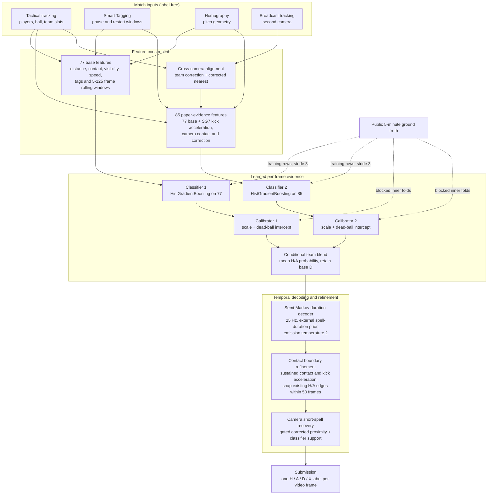

# Possession model

The saved default is **[models/possession_model.joblib](models/possession_model.joblib)**.
It contains two small team-symmetric classifiers, their calibrators, feature schemas
and the duration prior. It runs on CPU with the supplied challenge tracking/tagging;
no external dataset, downloaded checkpoint, video or PyTorch is required.

**Public training spellF1: 0.9882. MacroF1: 0.9919.** The submission predicts
all 17 public possessions (17 versus 17 real). The requested training spellF1
target of at least 0.75 is reached and verified by the official scorer.

**Five-fold blocked cross-validation spellF1: 0.7750. MacroF1: 0.8880.** These
are pooled out-of-fold scores, with nested calibration. The previous model
scored **0.6429 / 0.8919** under the same protocol: held-out spellF1 improves by
0.1321 while macroF1 decreases by 0.0039. Against the same blend without the new
recovery step, recovery adds **0.0817 spellF1 / 0.0012 macroF1** and raises
held-out predicted possessions from 13 to 15 against 17 real spells. These are
exploratory results on 17 public possessions, not private full-match scores.

The previous artifact is preserved as
[models/possession_baseline.joblib](models/possession_baseline.joblib), together
with its metadata, held-out predictions and full submission.

## How the model works

The model does not classify each frame independently and then smooth the result. Two
classifiers provide per-frame H/A/D evidence, and a semi-Markov decoder chooses the
whole label sequence that best balances that evidence against realistic possession
and dead-ball durations. Physical contact refinement then aligns the surviving H/A
edges to observed player-ball events, and a gated camera pass restores short spells
that the duration prior would otherwise erase.



| stage | what it decides | why it is there |
|---|---|---|
| Inputs | Tactical frame index, team ownership, ball state | Submission rows are tactical-video frames |
| Features | Physical and temporal evidence per frame | Gives the classifiers geometry, visibility, tags and motion |
| Classifiers | H/A/D probability per frame | Learns from the public five minutes only |
| Calibration + blend | Trustworthy H/A probabilities, shared live/dead mass | Two complementary feature views, one team-symmetric decision |
| Semi-Markov decode | Whole possession sequence | Prevents unrealistic flicker and enforces plausible spell lengths |
| Contact refinement | Exact H/A transition times | Snaps model edges to observed player-ball contact or kicks |
| Camera recovery | Missing short spells | Restores briefly supported possession changes suppressed by the prior |
| Output | 199,319 frame labels | `frame,label` submission |

## Run and compare

```bash
source .venv-ball/bin/activate
export OPENBLAS_NUM_THREADS=4 OMP_NUM_THREADS=4
python -m possession.run
python -m possession.compare
python -m possession.validate
python evaluation/bootstrap_evaluation.py --draws 10000
python evaluation/validate_submission.py evaluation/results/possession_model.csv
```

The default run writes all 199,319 frame labels to
`evaluation/results/possession_model.csv`, plus a JSON report. The comparator
uses pooled cross-validation predictions rather than the submission's training score.

| Entry | Pooled CV spellF1 | MacroF1 |
|---|---:|---:|
| Current blend + kick refinement + camera recovery, temperature 2 | **0.7750** | **0.8880** |
| Same blend + kick refinement without camera recovery, temperature 2 | 0.6933 | 0.8869 |
| Same classifiers and refinement, temperature 5 | 0.6800 | 0.8912 |
| Previous saved model | 0.6429 | 0.8919 |
| baseline_smooth125 | 0.4242 | 0.5812 |
| baseline_smooth50 | 0.3256 | 0.6207 |
| baseline_smooth25 | 0.2868 | 0.6200 |
| baseline_raw | 0.0378 | 0.5972 |

**Why the previous model also had a 0.7429 score:** that was its public training
spellF1, evaluated on labels used to fit it. Its held-out spellF1 was 0.6429.
The original report is preserved at `evaluation/results/possession_baseline.json`.
The new model's public training score is **0.9882 spellF1 / 0.9919 macroF1**
(previously **0.7429 / 0.9740**), recorded in `evaluation/results/possession_model.json`.
The official scoreboard evaluates each full submission on the public window,
so its result for a public-label-trained model is a training score. Compare
models using `possession.compare` and `experiments/validation_report.json`.

To run the preserved previous model:

```bash
python -m possession.run --model models/possession_baseline.joblib --out evaluation/results/possession_baseline.csv
```

## Reproduction

```bash
python3 -m venv .venv-ball
.venv-ball/bin/python -m pip install -r requirements-model.txt
source .venv-ball/bin/activate
export OPENBLAS_NUM_THREADS=4 OMP_NUM_THREADS=4
python -m possession.selfcheck
python -m possession.train
python -m possession.validate
python -m possession.run
python -m possession.compare
```

Python 3.11+ is required; development used Python 3.14. Dependencies are pinned,
and saved classifiers require scikit-learn 1.8.0. Default artifacts use format 2;
format 1 remains supported for the previous model.

`python -m possession.train --baseline` rebuilds the previous model separately;
`python -m possession.validate --baseline` writes separate baseline validation
outputs. Paper ablations reproduce with:

```bash
python -m experiments.object_context
python -m experiments.paper_evidence
python -m experiments.paper_boundaries
python -m experiments.temperature_pool
```

All feature construction and training use allowed public labels and supplied
challenge inputs. The duration prior was originally fitted on an unrelated public
IDSSE match; its parameters are bundled, with attribution in
[external-training-data.md](research/external-training-data.md).

## Selected method

1. Keep the original 77 physical, tracking-quality, temporal and automatic-tagging
   features. Dummy goalkeeper observations with missing speed are excluded.
   Interpolated ball positions retain explicit missingness flags.
2. Reuse label-free broadcast alignment and mutual nearest-player geometry to
   correct tactical team assignments. Add eight soft features: mapped observed
   ball, team-correction fraction, corrected H/A contact and its 25/101-frame means.
   The second classifier therefore receives 85 features.
3. Fit the original shallow histogram gradient booster on 77 features and a second
   on 85, with team-swapped training and symmetric prediction for both.
4. Fit each model's two-parameter calibrator from inner blocked held-out training
   predictions. Preserve the original model's D probability; average the two
   models' conditional H/A probabilities and multiply by the original live mass.
   This adapts the papers' separate live/dead and team-possession reasoning without
   training a new temporal network.
5. Decode each half with the unchanged exact 25-Hz semi-Markov duration model,
   saved emission temperature 2 and censored-edge survival probabilities. Legacy
   models without a temperature field retain 5. The smaller temperature allows
   classifier-supported short spells to overcome the duration prior more readily.
6. Refine only existing H/A boundaries to nearby new-team contact onsets. Retain
   the original eight-frame sustained co-motion rule. Also accept exclusive
   proximity intervals containing observed-ball acceleration at least 4 m/s²,
   using seven-frame degree-two Savitzky-Golay derivatives. Derivatives stay inside
   observed runs and halves; motion above 60 m/s or 150 m/s² is rejected. Unsupported
   acceleration is zero. Refinement searches within 50 frames, preserving spell
   count, label order and every D boundary.
7. Recover short spells suppressed by the duration prior only inside label-free
   spans where broadcast-to-tactical team correction was active. A 12-frame
   (0.48 s) run is accepted when the corrected camera places the alternative team
   within 2.5 m and the current team beyond 3 m, and the calibrated classifier
   gives that alternative at least 0.4 mean probability. The rule can only flip
   H/A runs; dead-ball frames and all unselected H/A edges are preserved. The
   full submission reports 8 recovered runs. Inside the scored public window two
   recoveries take the predicted possession count from 13 to 17; pooled
   cross-validation goes from 13 to 15 predicted spells.

The system uses offline future tracking context. No clock, frame number, event ID,
private labels or manual output corrections enter classification. See
[paper-combination-results.md](research/paper-combination-results.md) for all four
paper reviews, unsuccessful feature additions and the selected combination.
The follow-up [training-target experiments](research/training-target-results.md)
cover stronger learners, spell weighting, posterior spell-risk decoding and the
temperature change that clears 0.75 without changing the classifiers.

## Validation and limits

The earlier term "held-out" referred to the test minute within each of these
five folds: this was already cross-validation, not a single train/test split.

Five contiguous one-minute outer folds each exclude their labels and a ten-second
training embargo on both sides. Each classifier's calibrator uses inner held-out
predictions from allowed training frames, with both embargoes enforced. The same
outer model supplies the complete public context before decoding and retaining its
held-out minute. The selected production predictions exactly match the experiment.

`experiments/validation_report.json` includes each fold's scores, pooled
out-of-fold scores, and the mean and population standard deviation across folds.
Mean per-fold spellF1 is **0.6794 ± 0.1550**; mean per-fold macroF1 is
**0.7026 ± 0.1399**. These differ from pooled scores because minute boundaries
clip possession spells and two folds contain no D examples. The official metric
assigns an absent class F1 zero when computing each fold's three-class macroF1.

On the public window the current submission predicts 17 possessions against 17
real ones, compared with 13 before the camera-recovery step. The pooled
cross-validation output predicts 15.

A seeded paired bootstrap (`evaluation/bootstrap_evaluation.py`, 10,000 draws,
seed 0) resamples whole possessions for spellF1 and whole ground-truth segments
for macro-F1. Results are in `experiments/bootstrap_report.json`:

| model | spellF1 (90% interval) | macroF1 (90% interval) |
|---|---:|---:|
| Current | **0.7750** (0.5875–0.9318) | 0.8880 (0.7663–0.9337) |
| Previous saved model | 0.6429 (0.4143–0.8343) | 0.8919 (0.7773–0.9355) |

The paired spellF1 difference is **+0.1321** (90% interval **−0.0125 to
0.3089**); the current model is better in **93.6%** of paired draws, but zero is
still inside the interval. The paired macroF1 difference is **−0.0039**
(−0.0363 to 0.0211). Per-fold intervals are also in the report, but each fold has
only four or five possessions, so they are correspondingly coarse. Repeated
selection on this small public sample remains optimistic. Public ball visibility
is 88.2%, versus about 59.3% over the full graded match, so these results do not
establish full-match accuracy.

Original research notes and historical experiments remain for inspection:

- [Verified possession methods](research/verified-possession-methods.md)
- [Ball Radar review](research/ballradar-review.md)
- [Ball reconstruction papers](research/ball-imputation-review.md)
- [Local ball reconstruction benchmark](research/local-ball-benchmark.md)
- [Grouped-frame experiments](research/grouped-frame-results.md)
