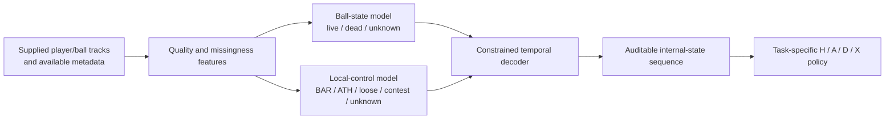

# Football possession classification from tracking data

## Status and scope

**Evidence review: PASS WITH OPERATIONAL BLOCKERS.** This is a research memo and conditional system design, not a reproduced Barcelona–Athletic result. The requester supplies the output contract: `H` = Barcelona controls a live ball, `A` = Athletic controls a live ball, `D` = play interrupted, `X` = abstention; during possession scoring, `X` is filled with the last known label in that half. No target data schema, organiser annotation manual, or scoring implementation was supplied. Consequently, recommendations about feature availability and the safest use of `X` are explicitly **unverified for the target feed**.

## Executive summary

Given player/ball trajectories and tactical context, the central task is structured temporal inference of (1) live/dead status, (2) team control, and (3) control-change time. The hard cases—deflections, duels, loose/aerial balls, interruptions, and tracker loss—make independent frame classification fragile.

Directly relevant examples reviewed here are Link & Hoernig (2017), which separates individual possession, team possession, and stricter ball control from tracking trajectories [2]; Vidal-Codina et al. (2022), which has distinct `dead ball`, `no possession`, `possession`, and `duel` states [3]; and PathCRF (2026), which decodes a constrained possession path globally [4]. PathCRF is **not** a joint solution to this task’s D/live question: it restricts training and inference to presegmented in-play episodes [4]. The public Sportec Open DFL / IDSSE data is a provider-labelled reproducible starting point, with ball-active and ball-owning-team fields [5, 6], but it is not independently verified ground truth for this task’s exact convention.

**Recommendation:** maintain richer internal states for ambiguity, then map them to the requester’s H/A/D/X contract only via a declared policy validated on target-style annotations. A turnover should occur on supported opponent control, not automatically on the first opponent contact. This is a design hypothesis grounded in the cited definitions; it is not a claimed optimal rule.

## 1. What can be established from sources

IFAB Law 9 defines the legal out-of-play condition: the ball is out when it wholly crosses a boundary, when the referee stops play, or in specified official-contact cases; otherwise it is in play [1]. The task’s `D` label describes interruption, but an actual pipeline still needs a source of evidence for whistles, boundary crossings, and restart timing.

Tracking-based possession work supports keeping control distinct from live/dead status. Vidal-Codina et al. use four continuous ball-control categories—dead ball, no possession, possession, and duel [3]. Link & Hoernig define team possession as an unbroken sequence of individual possession phases and distinguish this from stricter ball control; their team sequence can span a ball-flight interval with no individual controller [2]. Opta’s public methodology instead says a possession ends when the opponent gains control and leaves some in-play events unassigned [7]. These are legitimate, incompatible aggregation conventions.

### Proposed internal representation (not a source-mandated label standard)

| Layer | Values | Purpose |
|---|---|---|
| `ball_state` | `live`, `dead`, `unknown` | Separate interruption inference from ownership. |
| `control_state` while live | `Barcelona`, `Athletic`, `loose`, `contested`, `unknown` | Do not invent an owner during flight, deflection, duel, or missing tracking. |
| `controller` | player ID, `none`, `multiple`, `unknown` | Optional diagnostics and fine-grained training target. |
| `evidence` | geometry, trajectory change, metadata/event cue, manual review | Audit every disputed boundary. |

### Output mapping is a target-policy decision

The requester fixes the meanings of H/A/D/X but does **not** specify a gold-label policy for internally `loose` or `contested` live frames. Do not assume that `X` is score-optimal merely because it is available: its required backfilling can alter possession totals and transition timing. Before implementation, obtain the official label manual and scorer; then select an exhaustive mapping for `{loose, contested, unknown}` using only development matches and report its effect. Until then, the defensible research stance is **unresolved/blocked**, not “use X.”

## 2. Possession-change rule: control gain, not first contact

A same-team pass can change the player controller without changing team possession. An opponent deflection or 50–50 is evidence of `loose`/`contested`, not necessarily a turnover. A candidate team boundary is the first supported opponent-controlled recovery, reception, dribble, pass, or equivalent control action.

- Link & Hoernig’s team possession is an unbroken chain of individual possessions and can include ball flight [2].
- Vidal-Codina et al. require more than proximity for a gain and separately label duel/no-possession states [3].
- Opta’s published methodology uses opponent control—not a defensive action alone—as the possession-ending criterion [7].

This rule is an **operational hypothesis**. Its treatment of one-touch interceptions and aerial balls must be checked against the requester’s reference labels. In particular, do not impose an unconditional intermediate loose/contest state between H and A: PathCRF’s player-level graph permits pass-flight followed by a control or one-touch kick [4].

## 3. Conditional model architecture

The architecture below assumes the feed actually provides the indicated variables. Confirm field meanings, coordinate units, sampling alignment, identity stability, ball height, missingness flags, tactical labels, and live/dead semantics before model selection.

### Features and local models

If available, use ball position/velocity/acceleration; player–ball relative distance and closing velocity; team IDs; pitch geometry; and source-specific confidence/missingness indicators. Link & Hoernig use player–ball distance, motion, ball acceleration, and nearby-opponent context [2]. Vidal-Codina et al. use tracking and player configurations in dead-ball/restart analysis [3]. These examples do not verify that any named field exists in the target input.

### Temporal decoding

PathCRF demonstrates constrained CRF/Viterbi sequence decoding over player trajectories, masking physically inconsistent transitions [4]. Its transferable lesson is narrow: globally decoding a sequence can suppress impossible local flicker. It does **not** establish a joint live/dead-control decoder because the authors restrict both training and inference to preidentified in-play segments [4].

A proposed baseline is a CRF or hidden semi-Markov model over `{BAR, ATH, loose, contested, dead}`, augmented with an observation-quality flag. The state-to-H/A/D/X mapping, abstention threshold, and loss must be selected against a target-consistent development set. This proposal is not empirically validated here.

### Ball tracker loss

Missing ball observations are not proof of D. The evidence reviewed documents that tracking can suffer from occlusion and errors [5], while PathCRF’s player-only method assumes in-play segmentation rather than solving stoppage detection [4]. Treating such gaps as `unknown` is therefore a cautious **untested policy** to validate against target labels; use D only when interruption evidence is available.

## 4. Evaluation plan

Frame accuracy alone can conceal poor transition timing because stable possession dominates a match. Fix all definitions and tolerances before tuning.

| Unit | Measure | Note |
|---|---|---|
| Play status | classwise precision/recall/F1 for live/dead; unknown coverage | Requires a target-consistent D reference. |
| Controlled live frames | macro-F1 for H/A | Exclude or separately score frames whose target convention is ambiguous. |
| Turnovers | precision/recall at a declared temporal tolerance; signed timing error | Directly measures the difficult requirement. |
| Transition types | confusion matrix: same-team transfer, recovery, deflection/loose, duel, restart | Makes semantic mistakes visible. |
| X | coverage plus conditional error rate; scorer-specific utility | Must reflect the supplied backfilling/scoring implementation. |
| Generalisation | match-held-out splits | Avoid adjacent-frame leakage. |

Link & Hoernig use transition-oriented validation with temporal tolerance [2], and Vidal-Codina et al. compare detected events with manual annotations [3]. The table extends those ideas to the requester’s contract and is a proposed protocol.

## 5. Data and benchmarks

### Sportec Open DFL / IDSSE: recommended public provider-label starting point

Bassek et al. describe seven 2022/23 German matches with synchronized event/tracking XML and ball x/y/z/speed, player trajectories, ball status, and ball possession fields [5]. Kloppy documents exposed `ball_state` and `ball_owning_team_id` columns [6]. This makes it suitable for reproducing a **provider-labelled** team-owner/live-status benchmark.

Limits: seven matches cannot establish broad transfer; the inspected schema does not document individual possessor IDs; source synchronization has documented uncertainty; and the provider fields may not match the Barcelona–Athletic label convention [5, 6]. Do not describe it as target ground truth without adjudication.

### Other public inputs

- **Metrica sample data:** synchronized anonymized tracking/event examples, useful for ingestion/alignment prototypes; the README does not document dense possession labels or a conventional open-data licence [8].
- **SoccerNet Tracking:** a perception/tracking benchmark useful only if player/ball tracks must be reconstructed from video; it is not documented as a dense possession-label dataset [9].
- **StatsBomb Open Data:** event/lineup context, not a documented continuous tracking-possession target [10].

## 6. Papers and repositories to inspect

| Item | Relevance | Important limitation |
|---|---|---|
| Link & Hoernig, *Individual ball possession in soccer* (2017) | Definitions, trajectory features, and transition-oriented validation. | Private Bundesliga data; convention may differ. [2] |
| Vidal-Codina et al., *Automatic event detection in football using tracking data* (2022) | 25-Hz tracking pipeline; dead/no-possession/possession/duel and restart logic. | Provider-specific status signals and calibrated rules. [3] |
| Kim et al., *PathCRF* (2026) | Constrained possession-path decoding from player trajectories. | In-play episodes are presegmented; not a joint dead-ball model. [4] |
| Bassek et al., *Integrated dataset…* (2025) | Public provider-labelled tracking/event data. | Seven matches; no released video. [5] |
| [PySport/kloppy](https://github.com/PySport/kloppy) | Multi-provider parsing/normalisation, including Metrica/Sportec routes. | Not a possession model. [11] |
| [DataBallPy](https://github.com/Alek050/databallpy) | Event/tracking synchronization and Sportec open-data loading. | Tooling, not a target classifier. [12] |
| [PathCRF code](https://github.com/hyunsungkim-ds/pathcrf) | Paper-linked implementation to inspect/reproduce. | No execution or code audit was performed here. [4] |
| [Metrica sample data](https://github.com/metrica-sports/sample-data) | Small synchronized parser/integration sample. | Label and licence limitations above. [8] |

## Open questions / blockers

1. **BLOCKED:** official H/A/D/X annotation definitions for loose, contested, aerial, and restart frames; exact treatment and cost of X.
2. **BLOCKED:** target feed schema and one sampled match: rate, coordinates, identities, ball z/confidence, missingness, event/tactical fields, and source of any live/dead flag.
3. **BLOCKED:** reference artifact for adjudicating disputed transition timing (video, provider label, or human annotation).
4. **UNVERIFIED:** whether the submitted algorithm must run online or can use future frames. This changes whether bidirectional/Viterbi decoding is permitted.

## Next steps

1. Obtain the organiser’s label manual, scorer, and input schema; make the H/A/D/X mapping exhaustive.
2. Create a small, stratified development set enriched for turnovers, deflections, duels, restarts, aerial balls, and tracking gaps.
3. Compare a geometry/trajectory rule baseline with a constrained temporal decoder using match-held-out validation.
4. Select X/abstention and internal-state mapping only on development matches using the actual scorer.
5. Publish a transition-error table and manually inspect every false turnover and D/X decision.

## Sources

1. IFAB. *Law 9: The Ball in and out of Play* (current). https://www.theifab.com/laws/latest/the-ball-in-and-out-of-play/
2. Link, D. & Hoernig, M. *Individual ball possession in soccer* (2017). https://doi.org/10.1371/journal.pone.0179953
3. Vidal-Codina, F. et al. *Automatic event detection in football using tracking data* (2022). https://doi.org/10.1007/s12283-022-00381-6
4. Kim, H. et al. *PathCRF: Ball-Free Soccer Event Detection via Possession Path Inference from Player Trajectories* (2026). https://arxiv.org/abs/2602.12080
5. Bassek, M. et al. *An integrated dataset of spatiotemporal and event data in elite soccer* (2025). https://doi.org/10.1038/s41597-025-04505-y
6. Kloppy. *Sportec loader documentation*. https://kloppy.pysport.org/user-guide/loading-data/sportec/
7. Stats Perform / Opta Analyst. *Sequences and Possessions in Football*. https://theanalyst.com/articles/possessions-and-sequences-in-football
8. Metrica Sports. *sample-data*. https://github.com/metrica-sports/sample-data
9. SoccerNet. *Tracking development kit*. https://github.com/SoccerNet/sn-tracking
10. StatsBomb. *Open Data*. https://github.com/hudl/open-data
11. PySport. *kloppy*. https://github.com/PySport/kloppy
12. Alek050. *databallpy*. https://github.com/Alek050/databallpy
